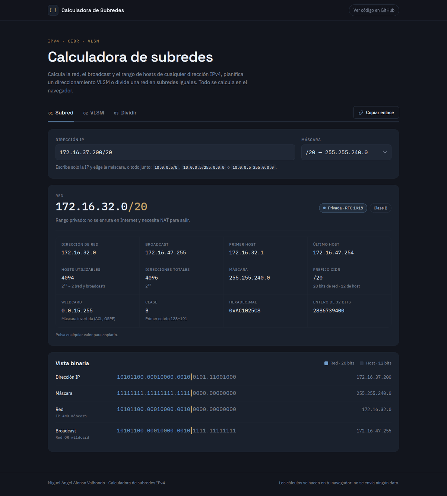
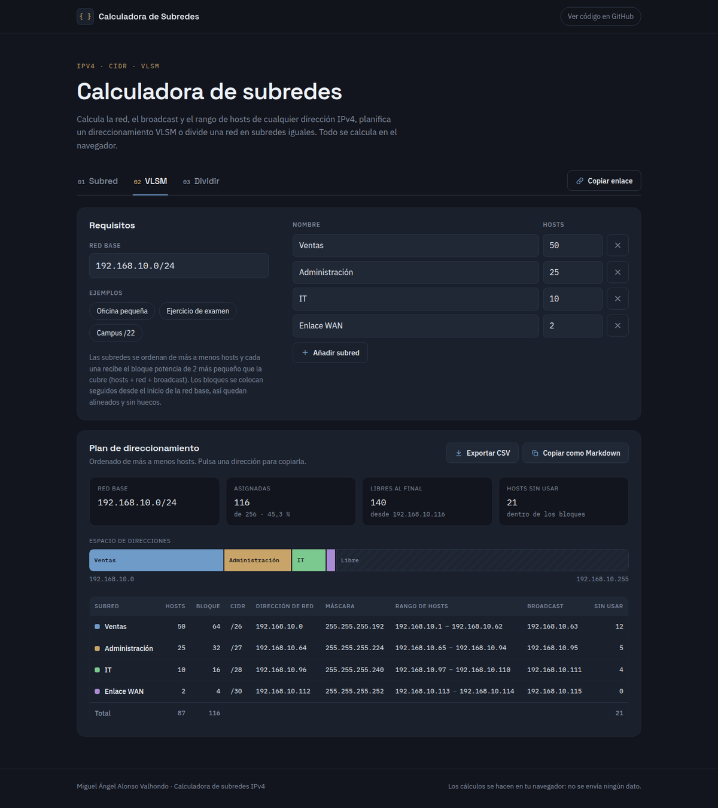
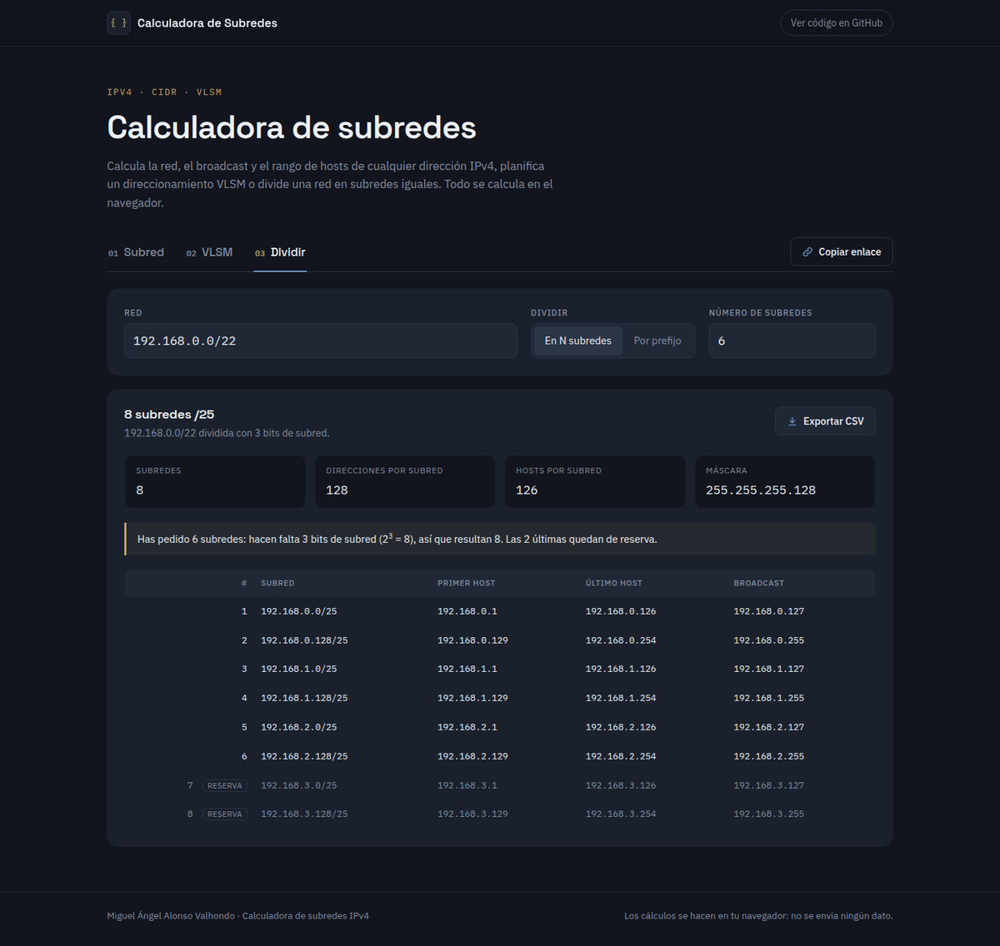
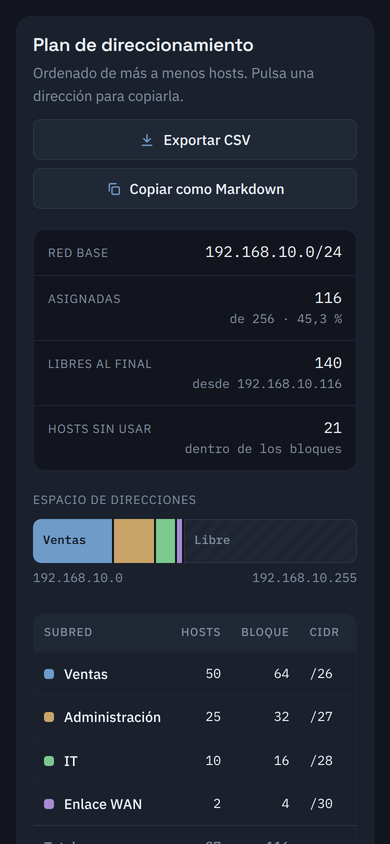

# Calculadora de subredes IPv4 y VLSM

Herramienta web para calcular subredes IPv4: a partir de una dirección y una máscara
muestra la red, el broadcast, el rango de hosts, la wildcard y la representación binaria;
planifica un direccionamiento VLSM a partir de una lista de subredes y divide una red en
subredes iguales. Está hecha con HTML, CSS y JavaScript sin frameworks ni dependencias,
con la lógica de red separada de la interfaz y cubierta por tests.

**Demo:** https://tu-dominio.netlify.app/demo-calculadora-subredes/





| Dividir | Móvil (390 px) |
| --- | --- |
|  |  |

## Funcionalidades

### Subred
- Acepta `IP/prefijo` (`192.168.1.10/24`), `IP/máscara`, `IP máscara` o solo la IP con un desplegable de máscaras de /0 a /32.
- Muestra dirección de red, broadcast, primer y último host, hosts utilizables, direcciones totales,
  máscara, prefijo CIDR, wildcard, clase (A–E), forma hexadecimal y entero de 32 bits.
- Identifica el tipo de dirección: privada (RFC 1918), pública, loopback, enlace local/APIPA,
  CGNAT (RFC 6598), multicast, reservada, broadcast limitado, «esta red», documentación y pruebas de rendimiento.
- Vista binaria de IP, máscara, red y broadcast con los bits de red resaltados y una marca en el límite red/host.
- Casos especiales explicados: /31 (enlace punto a punto, RFC 3021), /32 (un único host),
  y cuando la IP escrita es la propia dirección de red o de broadcast.
- Se recalcula mientras escribes, con mensajes de validación junto al campo
  (octeto fuera de rango, ceros a la izquierda, máscara no contigua…).

### VLSM
- Red base y lista editable de subredes (nombre y hosts), con filas que se añaden y se quitan.
- Tres ejemplos cargables: *Oficina pequeña*, *Ejercicio de examen* y *Campus /22*.
- Tabla con hosts pedidos, tamaño de bloque, CIDR, dirección de red, máscara, rango de hosts,
  broadcast y hosts sin usar, más una fila de totales.
- Barra del espacio de direcciones con cada bloque a escala y el espacio libre.
- Si el plan no cabe, indica cuántas direcciones hacen falta, el prefijo mínimo necesario
  y una red que lo contiene (con un botón para usarla).
- Exportar a CSV y copiar como tabla Markdown.

### Dividir
- Divide una red en N subredes iguales o en subredes de un prefijo dado.
- Si N no es potencia de 2, explica cuántos bits hacen falta y marca las subredes que sobran como reserva.
- La tabla pinta como máximo 1024 filas (avisando del total); el CSV exporta hasta 65.536.

### Común
- El estado (pestaña y datos) se guarda en la URL, así que un plan se comparte con el botón **Copiar enlace**.
- Al pulsar cualquier valor se copia al portapapeles, con aviso «Copiado».
- Navegable con teclado: pestañas con roles ARIA y flechas, foco visible, avisos para lectores de pantalla.
- Adaptada a móvil desde 360 px; las tablas anchas se desplazan dentro de su contenedor.

## Cómo funciona la asignación VLSM

1. Cada subred necesita sus hosts **más 2** direcciones (red y broadcast). Se redondea a la
   siguiente potencia de 2: ese es su bloque. El bloque mínimo es /30 (4 direcciones).
2. Las subredes se **ordenan de más a menos hosts**.
3. Los bloques se colocan **uno detrás de otro** desde el inicio de la red base.

Como los bloques van de mayor a menor y todos son potencias de 2, cada uno empieza en un
múltiplo de su tamaño (queda alineado) y no quedan huecos entre ellos.

Ejemplo con `192.168.10.0/24` (el preset *Oficina pequeña*):

| Subred | Hosts | Hosts + 2 | Bloque | Resultado | Rango de hosts | Broadcast |
| --- | ---: | ---: | ---: | --- | --- | --- |
| Ventas | 50 | 52 | 64 | 192.168.10.0/26 | .1 – .62 | .63 |
| Administración | 25 | 27 | 32 | 192.168.10.64/27 | .65 – .94 | .95 |
| IT | 10 | 12 | 16 | 192.168.10.96/28 | .97 – .110 | .111 |
| Enlace WAN | 2 | 4 | 4 | 192.168.10.112/30 | .113 – .114 | .115 |

Se usan 116 de las 256 direcciones; quedan libres de la 192.168.10.116 a la 192.168.10.255.
Si los bloques sumaran más de 256, la herramienta lo indica y propone la red mínima que los contiene.

## Decisiones técnicas

- **Lógica separada de la interfaz.** `js/ipv4.js` contiene solo funciones puras (sin DOM):
  recibe números y devuelve objetos. `js/app.js` se encarga de leer los formularios, pintar
  y exportar. Así la lógica se prueba en Node sin navegador.
- **Aritmética de 32 bits sin signo.** Las direcciones son enteros de 0 a 4.294.967.295.
  Los operadores de bits de JavaScript devuelven enteros *con* signo, así que tras cada
  operación se aplica `>>> 0` (por ejemplo, `(ip & mask) >>> 0`). El caso /0 se trata aparte
  porque en JavaScript `x << 32` equivale a `x << 0`.
- **Validación estricta.** Se rechazan octetos con ceros a la izquierda (`192.168.01.1`)
  porque algunas herramientas los interpretan en octal, y las máscaras no contiguas
  (`255.0.255.0`), que se detectan comprobando que la wildcard cumple `w & (w + 1) === 0`.
- **Sin frameworks ni paso de compilación.** Para una herramienta de este tamaño no aportan
  nada y añadirían dependencias. Todo el código que se ejecuta es el que está en el repositorio.
- **Scripts clásicos, no módulos ES.** Los navegadores bloquean `type="module"` al abrir un
  archivo con `file://`. Con scripts clásicos la página funciona con doble clic sobre
  `index.html` y también desde cualquier subcarpeta de un hosting estático. `ipv4.js` usa un
  envoltorio tipo UMD: en el navegador crea la global `IPv4` y en Node exporta con `module.exports`.
- **Seguridad del contenido.** Los nombres que escribe el usuario (y los que llegan por la URL)
  se escapan antes de insertarse como HTML. En el CSV se neutralizan los valores que empiezan
  por `=`, `+`, `-` o `@` para que Excel no los ejecute como fórmulas.
- **CSV para Excel en español.** Separador `;` y marca BOM UTF-8, para que se abra con las
  columnas y las tildes correctas.
- **Estado en la URL** con `history.replaceState`, que actualiza el enlace sin llenar el historial.

## Uso en local

No hace falta instalar nada: abre `index.html` con doble clic. También se puede servir con
cualquier servidor estático, por ejemplo `python -m http.server` desde la carpeta del proyecto.

## Tests

Requieren Node.js 18 o superior y no usan dependencias (`node:test` y `node:assert`):

```bash
node tests/ipv4.test.js
```

Cubren la lectura de direcciones y máscaras (formatos válidos, octetos fuera de rango, ceros
a la izquierda, entradas vacías, máscaras no contiguas), los cálculos de /0, /8, /20, /24,
/30, /31 y /32, la clasificación de rangos especiales, el tamaño de bloque por número de
hosts, la asignación VLSM (orden, alineación, sin solapes, casos que no caben) y la división
en subredes iguales.

## Estructura

```
calculadora-subredes/
├── index.html            Estructura de la página y las tres pestañas
├── css/
│   └── styles.css        Estilos (tema oscuro, responsive)
├── js/
│   ├── ipv4.js           Lógica de red pura, sin DOM (navegador y Node)
│   └── app.js            Interfaz: eventos, renderizado, portapapeles, CSV, URL
├── tests/
│   └── ipv4.test.js      Tests de ipv4.js con node:test
├── docs/                 Capturas de pantalla
├── LICENSE
└── README.md
```

## Limitaciones

- Solo IPv4.
- En VLSM se usa el criterio clásico de examen: un enlace de 2 hosts recibe una /30, no una /31.
- La asignación VLSM coloca los bloques desde el principio de la red base; el espacio libre queda al final.

## Autor

Miguel Ángel Alonso Valhondo — [LinkedIn](https://www.linkedin.com/in/miguelangel-alonso-valhondo)

## Licencia

[MIT](LICENSE)
